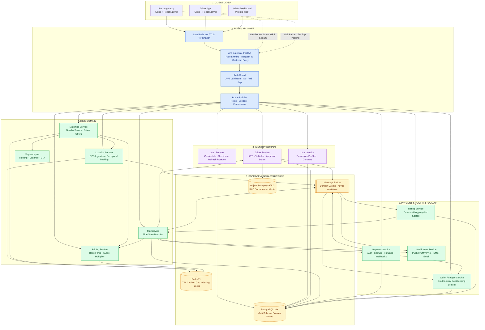
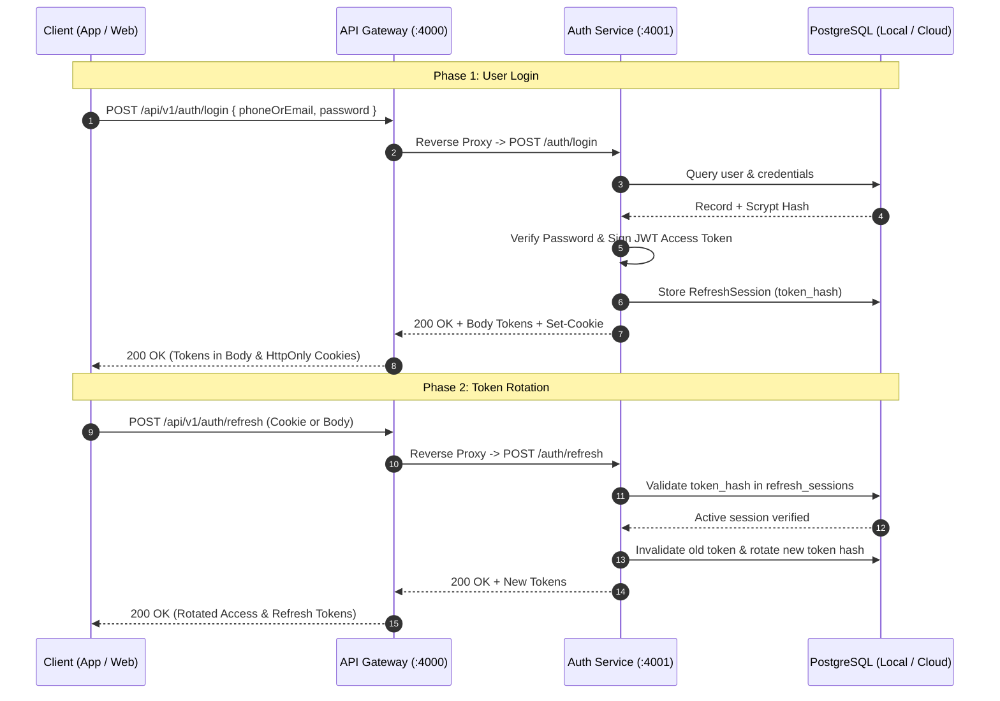
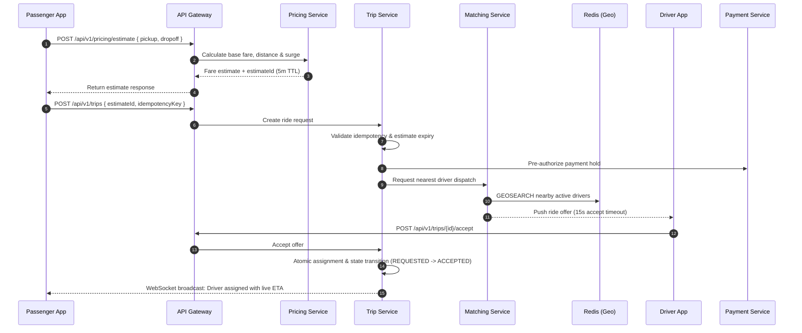

# Zyvo System Architecture

High-level architecture, service interactions, and request flows for the Zyvo microservices platform.

---

## 1. System Topology

---

## 2. Request Flows

### A. Authentication & Refresh Token Rotation

---

### B. Ride Booking & Concurrency-Safe Matching

---

## 3. Data Architecture Guidelines

* **Money Representation:** Always stored as integer **paise** (`Int`), never floating point numbers.
* **Timestamps:** ISO 8601 UTC with microsecond precision (`timestamptz(6)`).
* **Identifiers:** Universally Unique Identifiers (`UUIDv4`).
* **Cross-Domain References:** Service databases reference other domain entities strictly by UUID, avoiding physical database-level foreign key locks across decoupled service schemas.